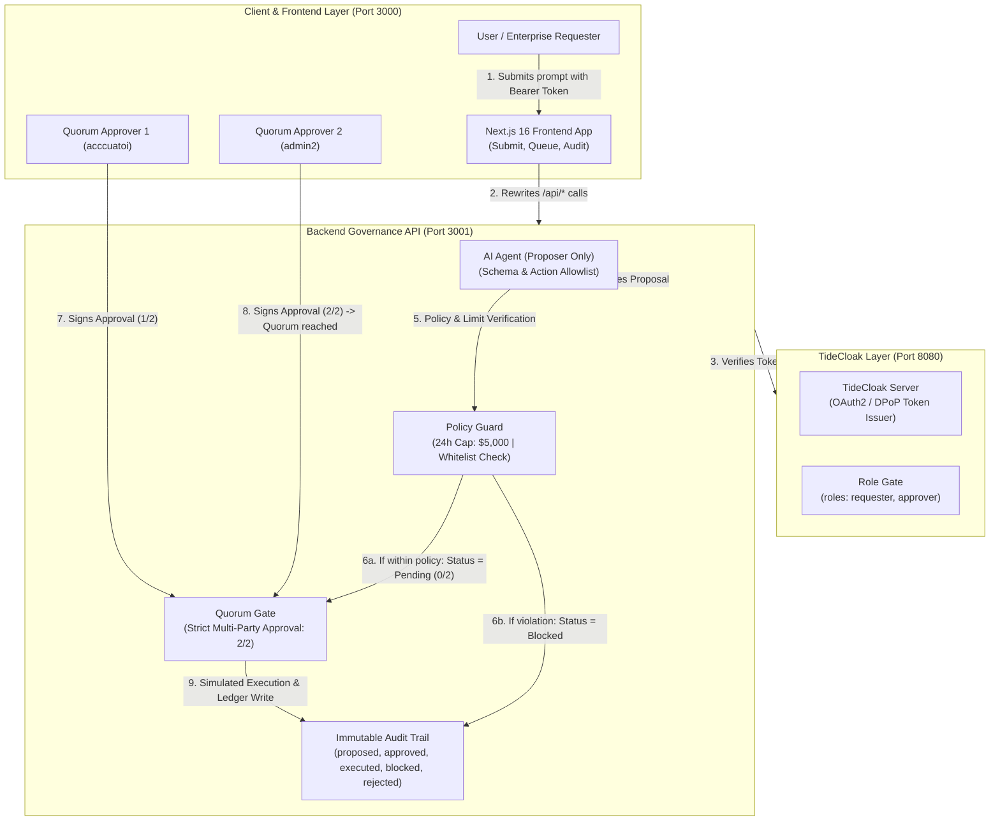

# SentinelAgent Architecture & Security Model

Tài liệu mô tả kiến trúc bảo mật của **SentinelAgent (Cháo Lươn 37)** kết hợp với TideCloak Authentication & Quorum Governance.

---

## 1. Các thành phần đã triển khai (Implemented Core)

1. **AI Agent Proposer (`backend/lib/agent/` & `frontend/app/(ui)/page.tsx`)**:
   - AI chỉ giữ vai trò **đề xuất (Proposer Only)**, tuyệt đối không sở hữu khóa ký hay quyền tự ý kích hoạt chuyển tiền.
   - Thẩm định cấu trúc dữ liệu theo schema khắt khe. Nếu phát hiện prompt injection hoặc yêu cầu ngoài phạm vi cho phép, output sẽ bị từ chối (`proposal: null`, `status: "blocked"`).

2. **Policy Guard (`backend/lib/server/policy.ts`)**:
   - Kiểm tra danh sách người thụ hưởng hợp lệ (Whitelist: AWS, Cloudflare, VNPT, Cty BĐS Hòa Bình,...).
   - Kiểm tra hạn mức chi tiêu trượt trong 24 giờ (Rolling 24h Cap: $5,000 USD).

3. **TideCloak Authentication & Role Access Control (`backend/lib/server/auth.ts`, `frontend/proxy.ts`)**:
   - Mọi API call được bảo vệ bằng TideCloak Access Token (`Authorization: Bearer <token>`).
   - Phân quyền theo vai trò người dùng: `requester` (tạo yêu cầu), `approver` (ký duyệt quorum).

4. **Quorum Approval Gate (`backend/app/api/requests/[id]/approve/route.ts`)**:
   - Yêu cầu đủ 2 chữ ký độc lập từ người dùng có quyền `approver`.
   - Ngăn chặn triệt để tự phê duyệt (Self-approval) và ký trùng lặp (Duplicate approval).
   - Chặn đứng mọi hành vi bypass trực tiếp: endpoint `/api/requests/:id/execute` luôn trả về HTTP 403 Forbidden và ghi log `rejected`.

5. **Cryptographic Audit Trail (`backend/app/api/audit/route.ts`, `frontend/app/(ui)/audit/page.tsx`)**:
   - Ghi lại toàn bộ tiến trình sự kiện (`proposed`, `approved`, `executed`, `blocked`, `rejected`) với thông tin thời gian, tác nhân và lý do chi tiết.

---

## 2. Lộ trình mở rộng tương lai (Planned Roadmap)

- **Tide Decentralized Threshold Key Synthesis**: Mở rộng từ quorum logic phía server sang mạng lưới phân tán 4/4 node của TideCloak để tổng hợp khóa ký giao dịch tạm thời (ephemeral keys) chỉ tại thời điểm đạt đủ điều kiện.
- **Hardware Enclave E2EE**: Tích hợp mã hóa đầu cuối và giải mã trực tiếp trong môi trường thực thi bảo mật (TEE).
