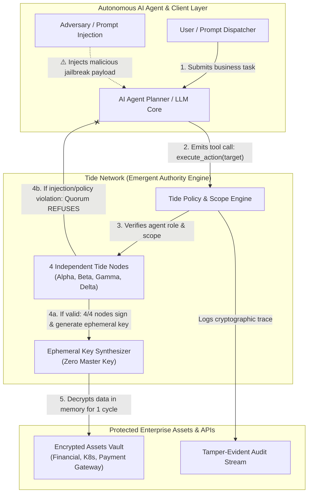

# SentinelAgent Architecture & Security Model

Tài liệu mô tả kiến trúc bảo mật của **SentinelAgent (Chao-Luon-37)** kết hợp với TideCloak Emergent Authority.

---

## Các thành phần cốt lõi

1. **AI Agent Planner (`ui/js/app.js`)**:
   - Tiếp nhận prompt, lên kế hoạch (reasoning) và sinh lệnh gọi công cụ (tool call).
   - Mô phỏng các chế độ: *Sentinel-Finance*, *Sentinel-DevSec*, và chế độ bị tấn công *Jailbroken / Injected Agent*.

2. **TideCloak Emergent Authority Gatekeeper (`ui/js/tidecloak-service.js`)**:
   - Đảm bảo tính bất biến: Không một AI agent, máy chủ hay quản trị viên nào nắm giữ Master Key tĩnh.
   - Thẩm định mọi hành động qua Quorum đồng thuận của 4 node độc lập.
   - Cơ chế thu hồi quyền tức thời (Instant Cryptographic Revocation).

3. **Decentralized Assets Vault (`ui/js/mock-data.js`)**:
   - Dữ liệu mật doanh nghiệp (Payment gateway token, báo cáo tài chính nội bộ, K8s secrets, PII database) được mã hóa dưới dạng Ciphertext và chỉ giải mã được khi có sự đồng thuận từ Tide Quorum.
